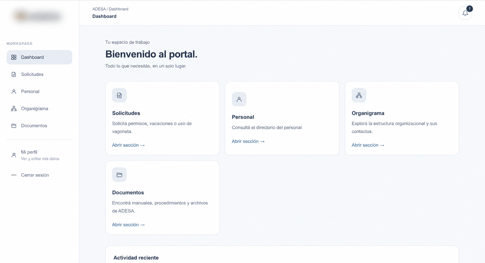
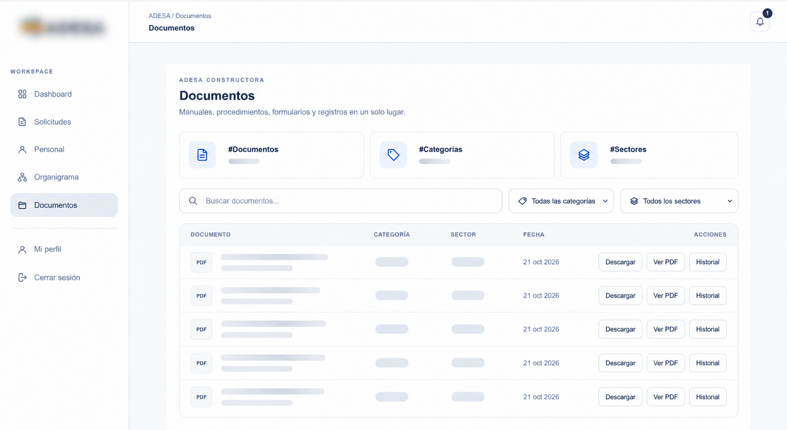
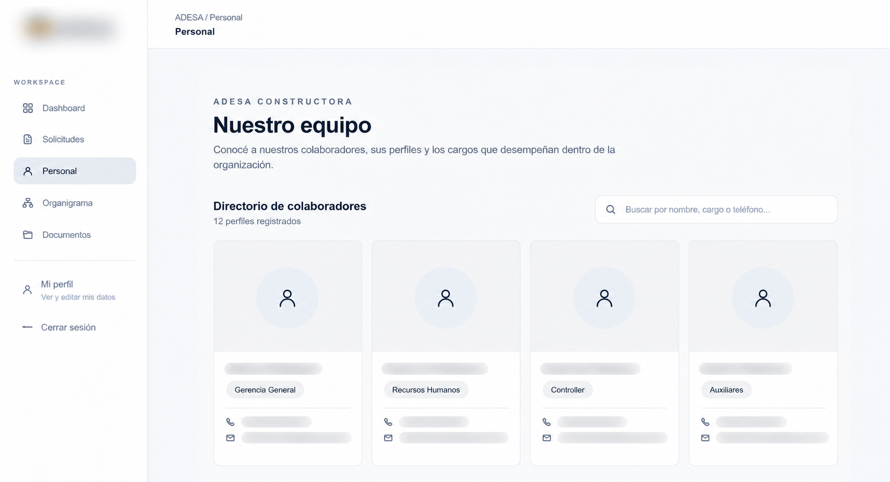
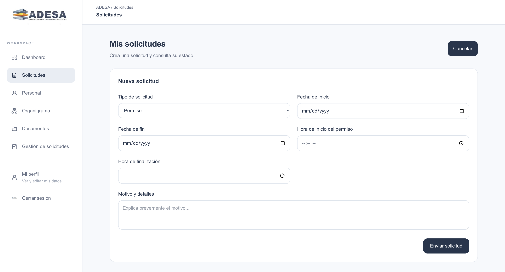

# Internal Operations Portal — Construction Company

Professional Experience | Business Process Improvement & Portal Development

## Overview

Designed and developed an internal operations portal for a construction company, focused on centralizing company resources, standardizing business processes, and improving access to operational information.

The portal brings together key workplace functions, including document management, employee directory, organizational structure, and digital request workflows.

## Portal Overview

The main dashboard provides a centralized workspace for accessing the portal's core modules.

## Key Features

### 1. Document Management

A centralized document interface designed to organize manuals, procedures, forms, and operational records in one place. Search and filtering options help users navigate resources by category and department.

### 2. Employee Directory

An employee directory interface designed to make organizational roles and contact information easier to access. The portfolio screenshot uses anonymized information.

### 3. Digital Request Workflow

A structured request form designed to support digital submission of employee requests, including leave or permission requests, with dates, times, and supporting details.

## Responsibilities & Contributions

- Standardized documentation across 10 key business processes.
- Organized and centralized more than 100 documents, forms, and operational resources.
- Structured process documentation to improve accessibility and consistency.
- Identified opportunities to digitize manual workflows and improve operational efficiency.
- Designed and developed an internal portal to organize operational information and support digital workflows.

## Technologies

- Next.js
- TypeScript
- Supabase
- GitHub
- Vercel

## Focus Areas

- Business Process Analysis
- Product Thinking and User Experience
- Operations Management
- Process Standardization
- Internal Tools Development
- Digital Transformation

## Confidentiality

This portfolio entry provides a high-level overview of professional work. It does not include internal source code, company documents, employee contact information, or confidential business data.
